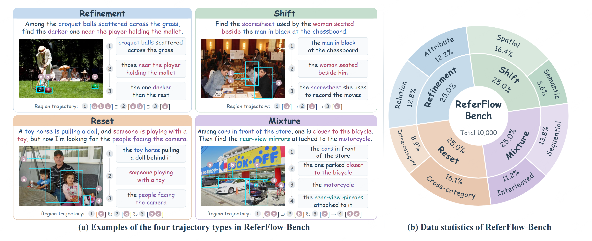

# ReferFlow-Bench

<p align="center">
  <a href="https://arxiv.org/abs/2610.20352"><b>Paper</b></a> |
  <a href="#referflow-bench"><b>ReferFlow-Bench</b></a> |
  <a href="https://huggingface.co/datasets/V-Insight/ReferFlow-Bench"><b>Dataset</b></a> |
  <a href="#evaluation"><b>Evaluation</b></a> |
  <a href="#leaderboard"><b>Leaderboard</b></a>
</p>

**ReferFlow-Bench** is a benchmark for trajectory-level referring expression comprehension (REC), introduced in **ReferFlow: Beyond Final-Target Localization for Complex Referring Expressions**. It contains **10,000 grounding trajectories** annotated at every step, to evaluate grounding consistency beyond final-target accuracy.

This repository provides the benchmark overview and evaluation code. Benchmark annotations and images are distributed through the [Hugging Face dataset](https://huggingface.co/datasets/V-Insight/ReferFlow-Bench). Model results are available on the [leaderboard](#leaderboard).

## Key Highlights

- **Trajectory-level evaluation.** Evaluates intermediate visual references as well as final targets, with target-region annotations at every grounding step.
- **Four trajectory types.** Covers **Refinement, Shift, Reset, and Mixture**, with **2,500 trajectories per type**.
- **10,000 reviewed trajectories.** Contains **34,525 grounding steps** across **9,741 images**, with trajectory lengths ranging from 2 to 8 steps.
- **Three complementary metrics.** Reports **Q-Acc**, **T-Acc**, and **F-Acc** for step-level, trajectory-level, and final-step accuracy.

## ReferFlow-Bench

**ReferFlow-Bench** contains **10,000 grounding trajectories** with target-region annotations for every step. It evaluates whether models consistently ground intermediate visual references as their dependencies on prior regions change.

<p align="center">
  <a href="./Figs/ReferFlow-bench.png"></a>
</p>

*Examples of the four trajectory types and the distribution shown in the paper. Subtype proportions in this figure differ from the current released annotations.*

- **Refinement:** progressively narrow a previously identified set of candidate regions.
- **Shift:** use a previously grounded region as a reference to locate another region.
- **Reset:** locate a new target independently of previously grounded regions.
- **Mixture:** combine multiple transition types within one trajectory.

Each model receives an image and the complete ordered sequence of grounding steps, then predicts all target regions in a single response. Ground-truth boxes, target counts, transition labels, and dependency labels are excluded from the model input.

## Download Data

Download `annotation.jsonl` and `images.zip` from the [Hugging Face dataset](https://huggingface.co/datasets/V-Insight/ReferFlow-Bench). Extract `images.zip` alongside the annotations.

## Evaluation

1. Run your model on the image and all ordered grounding queries in a single turn.
2. Save one JSONL prediction per trajectory, keyed by `sample_id`.
3. Run the evaluation script:

```bash
cd ReferFlow-Bench/evaluation
python get_prediction_Acc.py --annotation_file /path/to/annotation.jsonl --prediction_file /path/to/predictions.jsonl
```

The evaluator reports **Q-Acc**, **T-Acc**, and **F-Acc** at IoU ≥ 0.5, including breakdowns by trajectory type, subtype, and length. See [`evaluation/README.md`](./evaluation/README.md) for the prediction format and a Qwen3-VL single-GPU inference example.

A grounding step is correct only when the predicted and target box sets contain the same number of boxes and admit a one-to-one matching with **IoU ≥ 0.5** for every pair.

- **Q-Acc:** average fraction of correctly grounded steps per trajectory.
- **T-Acc:** fraction of trajectories with every step correct and no extra predicted steps.
- **F-Acc:** accuracy at the specified final step.

Missing or unparseable predictions count as incorrect. Extra predicted steps are excluded.

## Leaderboard

Compare model performance and explore benchmark results on the [ReferFlow-Bench leaderboard](https://referflow-bench/lesderboard/). We welcome community submissions: send the model name, model size, prediction JSONL, evaluation output, and inference settings to [tyigao@stu.xjtu.edu.cn](mailto:tyigao@stu.xjtu.edu.cn).

## Contact

[tyigao@stu.xjtu.edu.cn](mailto:tyigao@stu.xjtu.edu.cn)

## License and Citation

Code and new annotations are released under [CC BY-NC 4.0](./LICENSE). Source images retain their original licenses; the dataset includes per-image attribution.

```bibtex
@misc{gao2026referflow,
  title = {ReferFlow: Beyond Final-Target Localization for Complex Referring Expressions},
  author = {Gao, Tianyi and Fang, Han and Wei, Xin and Zhong, Yaoyao and Pan, Zhaoyan and Zhu, Weijie and Sun, Hongbo and Lin, Zhiyu and Yang, Kaicheng and Xu, Jinglin and Yuan, Ye and Li, Hao and Sun, Hao and Xin, Jingmin},
  year = {2026},
  eprint = {2610.20352},
  archivePrefix = {arXiv},
  primaryClass = {cs.CV},
  url = {https://arxiv.org/abs/2610.20352}
}
```
